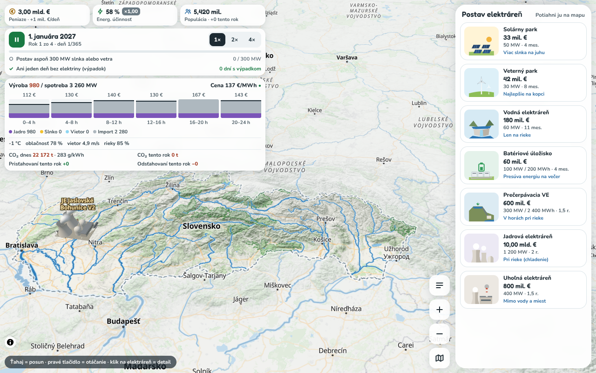

# Nivis – energetika Slovenska na skutočnej mape

Vzdelávacia strategická hra pre stredoškolákov (súťaž „Hackni vedu“, tím NiVis, Gymnázium Šrobárová 1, Košice).
Hráč je 4 roky (2027 – 2030) ministrom energetiky Slovenska, stavia elektrárne na 3D mape a na konci roka
dostane známku A – E, grafy a otázky.

Toto je prepis pôvodnej hry (`reference/Main.dc.html`, Three.js s modelovaným terénom) na samostatnú webovú
aplikáciu: **MapLibre GL JS** so skutočnými podkladmi **OpenStreetMap** (OpenFreeMap) a skutočným reliéfom
(AWS Terrain Tiles). Simulácia, pravidlá, texty a UI sú prenesené 1 : 1.



## Spustenie

Potrebný je Node.js 20+ (testované na 22).

```bash
npm install
npm run dev        # vývojový server → http://localhost:5173
npm test           # Vitest: simulácia + pravidlá stavania
npm run build      # produkčný build do dist/
npm run preview    # náhľad buildu → http://localhost:4173
npm run test:e2e   # Playwright smoke test (desktop + mobil)
```

Aplikácia nepotrebuje žiadny API kľúč. Voliteľne sa dá terén brať z MapTiler (`terrain-rgb-v2`) –
skopíruj `.env.example` do `.env` a doplň `VITE_MAPTILER_KEY` (súbor `.env` sa necommituje).

Prečo nie claude.ai artefakt: tam sú externé požiadavky blokované, mapa potrebuje dlaždice z internetu.

### Nasadenie na GitHub Pages

Workflow `.github/workflows/deploy.yml` pri pushi do `main` spustí testy, build a nasadí `dist/`.
V repozitári treba raz zapnúť **Settings → Pages → Source: GitHub Actions**. Build používa relatívne cesty
(`base: './'`), takže funguje aj v podpriečinku `https://<user>.github.io/<repo>/`.

## Architektúra

```
src/
  sim/      čistá logika bez DOM – port simulácie z referencie
            constants.ts (items, texty, farby…), sim.ts (Game: newGame, stepDay, endYear…),
            missions.ts, events.ts, report.ts (ročná správa, HUD, info o elektrárni, grafy)
  rules/    evaluate.ts – pravidlá stavania nad lon/lat v km, dem.ts – výškový sampler
  map/      map.ts (MapLibre, štýl, terén, hillshade, obloha, maska mimo SR),
            layers.ts (národné parky, výberová vrstva elektrární), camera.ts
  models/   models.ts (procedurálne modely elektrární – port buildModel/turbine…),
            three-layer.ts (jedna MapLibre custom vrstva so zdieľaným Three.js rendererom)
  ui/       App.tsx (herná slučka, ťahanie/presun/búranie), Hud, Dock, InfoCard, Intro,
            YearReport, Toast, Legend
  data/     sk-border, rivers, lakes, cities, protected (národné parky), neighbours – statické GeoJSON
public/
  style.json   upravený štýl OpenFreeMap Liberty
  dem-sk.bin   výšková mriežka Slovenska pre pravidlá (Int16, ~0,006° × 0,004°)
scripts/
  fetch-osm.ts   OSM → src/data/*.json
  build-dem.ts   AWS Terrarium z=10 → public/dem-sk.bin
  build-style.ts OpenFreeMap Liberty → public/style.json
```

Simulácia nezávisí od mapy: `Game` dostane zoznam elektrární `{type, units, lngLat, loc, build…}` a vracia stav;
UI a mapa sa prekresľujú zo stavu. Náhodu sa dá podstrčiť (`new Game({ rng })`), čo využívajú testy.

### Mapa
- **Podklad:** OpenFreeMap „liberty“ (`npm run build-style`): názvy `name:sk`, výrazné modré rieky (#2B7BB9) hrubnúce
  so zoomom, názvy riek kurzívou pozdĺž toku, vodné plochy #8EC3E6, menej POI, 3D budovy od zoomu 14.
- Nad podkladom je herná vrstva riek a jazier – presne tie, s ktorými počítajú pravidlá (viditeľné hlavne pri malom zoome).
- **Terén:** AWS Terrain Tiles (Terrarium), `exaggeration 1.4`, hillshade, obloha s hmlou.
- **Satelit:** tlačidlo s vrstvami prepína podklad na satelitnú snímku (voľba sa pamätá v prehliadači). Bez kľúča
  [Sentinel-2 cloudless 2025](https://s2maps.eu) od EOX (10 m/px, CC BY-NC-SA 4.0 – nekomerčné použitie), s kľúčom
  `VITE_MAPTILER_KEY` ostrý MapTiler Satellite. Nad snímkou ostávajú 3D budovy z OSM, názvy, rieky, parky a elektrárne.
  ZBGIS ortofoto (ÚGKK SR) by bolo najostrejšie, ale jeho služba nebola pri vývoji dostupná na overenie.
- **Maska** mimo Slovenska (55 % priehľadná) + hraničná čiara. Národné parky sú vyznačené zelenou.
- **Kamera:** štart na celé Slovensko (náklon 50°, natočenie −10°), stred kamery obmedzený na [16.3, 47.4] – [23.0, 49.9],
  zoom 6 – 16 (na mobile na výšku od 5, inak sa Slovensko nezmestí). Ťahanie = posun, pravé tlačidlo/Ctrl = otáčanie
  a náklon, koliesko = zoom; na mobile 1 prst posun, 2 prsty zoom/otáčanie.

### Pravidlá stavania (`src/rules/evaluate.ts`)
Počítajú sa zo statických dát, nikdy z toho, čo je práve na obrazovke. Vzdialenosti v reálnych km
(lokálna projekcia, overené proti `turf.distance` < 1 %).

| Typ | Pravidlo |
|---|---|
| všetky | vnútri SR; nie v jazere (odstup 1,5 km, vodná 0); ≥ 3,5 km od inej elektrárne; úver max. −12 mld. €; nie v meste (batéria R·0,4+0,5, ostatné R·0,75+2 km, R = 0,9 + √(obyv./1000)·0,18) |
| okrem vodnej | nie priamo na rieke (< 1,2 km) |
| vodná | do 3,5 km od rieky → prichytí sa na tok a natočí po prúde (smer podľa výšky terénu) |
| jadrová | rieka do 6 km |
| prečerpávacia | výška ≥ 550 m, rieka do 6 km, **nové:** prevýšenie ≥ 200 m v okruhu 3 km (16 + 8 bodov) |
| **nové:** veterná, uhoľná | nie v národnom parku |

Výšky berie z `public/dem-sk.bin` (dekódované Terrarium dlaždice z=10, reálne metre bez prevýšenia).
`windFactor = 0.75 + 0.5·clamp((h−150)/900) + bonus za otvorenú polohu` (0,7 – 1,3),
`solarFactor` ako v origináli (juh lepší, mierne horšie nad 1 200 m).
Na umiestnenie modelov sa používa `map.queryTerrainElevation` (už vrátane prevýšenia).

### 3D modely
Procedurálne modely z referencie (vietor, voda, jadro, batéria, prečerpávačka, slnko, uhlie) v jednej custom vrstve.
Statické časti každého modelu sa zlučujú podľa materiálu (málo draw callov). Mierka je „herná“:
`165 m × clamp(2^(11 − zoom), 0,5, 40)` na jednotku modelu → pod zoomom 11 majú stálu veľkosť na obrazovke.
Lopatky sa točia podľa vetra zo simulácie, z uhlia ide dym, z chladiacich veží para, pri odstávke bliká červený kruh,
počas stavby je model béžové lešenie a rastie. Výber elektrárne: neviditeľná `circle` vrstva + `queryRenderedFeatures`.

## Dáta a licencie
- Mapa: © [OpenStreetMap contributors](https://www.openstreetmap.org/copyright), [OpenFreeMap](https://openfreemap.org), © [OpenMapTiles](https://www.openmaptiles.org/)
- Satelit: [Sentinel-2 cloudless – s2maps.eu](https://s2maps.eu) by EOX IT Services GmbH (Contains modified Copernicus Sentinel data 2025), CC BY-NC-SA 4.0
- Terén: [Mapzen / AWS Terrain Tiles](https://github.com/tilezen/joerd/blob/master/docs/attribution.md) (SRTM, EU-DEM, …)
- Rieky, jazerá, mestá, národné parky, hranica: OpenStreetMap (cez Nominatim); doplnkovo Natural Earth (`reference/nivis-sk.json`)

### Obnovenie dát
```bash
npm run fetch-osm     # OSM → src/data/*.json (Overpass, ak je dostupný; inak Nominatim; fallback nivis-sk.json)
npm run build-dem     # AWS Terrarium → public/dem-sk.bin (~180 dlaždíc, cache v .cache/)
npm run build-style   # OpenFreeMap Liberty → public/style.json
```
`npm run fetch-osm -- --fallback` vytvorí hranicu, rieky a jazerá len z `reference/nivis-sk.json` (bez siete).

## Kontrola simulácie
`tests/unit/sim.test.ts` spustí pôvodnú logiku (`reference/balance/main-logic.js`) aj TypeScript port s rovnakými
náhodnými číslami a porovná ročné správy – sú **zhodné do posledného znaku** (stratégie „none“ aj „green“).
Potom overí kontrolné čísla (medián cez 15 seedov, ±3 body):

```
bez stavania:     každý rok D ≈ 50, CO₂ ≈ 285 g/kWh, dovoz ≈ 18 TWh
zelená stratégia: 2027 C 58 → 2028 ~69 → 2029 B 77 → 2030 B 77, OZE ≈ 29 %, CO₂ ≈ 181 g/kWh
```

Pôvodný test balansu: `cd reference/balance && node simtest.js main-logic.js none` (alebo `green`).

## Známe obmedzenia
- Hra potrebuje internet (dlaždice OpenFreeMap + AWS). Offline varianta cez PMTiles (Protomaps extrakt SR + Copernicus DEM)
  zatiaľ nie je hotová.
- NP Slovenský kras nemá v OSM vyhľadateľnú hranicu národného parku – použitý je geomorfologický celok Slovenský kras.
- Pri veľmi pomalom zariadení (< 20 fps) beží čas hry pomalšie (krok je obmedzený na 0,05 s/snímku ako v origináli).
